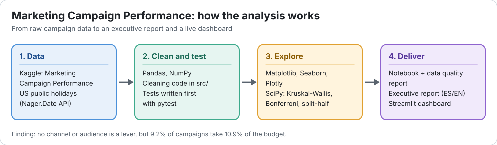

# Marketing Campaign Performance: Exploratory Data Analysis




[](https://marketing-campaigns-rita.streamlit.app/)

## 📋 Project Context

Exploratory data analysis (EDA) project for the AI Bootcamp at Factoría F5 (Mini Datathon). The goal is to load a dataset, clean it, explore it, visualize it and tell the story the data contains in an executive report aimed at a CEO.

The analysis is framed around how advertising drives user acquisition and engagement, the same question a Content Partners Data Analyst answers for streaming, CTV, gaming and content-app brands.

## 📊 Dataset

[Marketing Campaign Performance Dataset](https://www.kaggle.com/datasets/manishabhatt22/marketing-campaign-performance-dataset) (Kaggle).

- Campaign-level records with channel, campaign type, target audience, duration, location, language and customer segment.
- Performance metrics: impressions, clicks, conversion rate, acquisition cost, ROI and engagement score.
- The dataset appears to be synthetic, so differences between groups can be small. Findings are supported with statistical tests rather than eyeballed from charts.
- It has no retention data. Engagement score is the closest available proxy, and this is stated as a limitation in the report.

## ❓ Key Questions

1. Which channels acquire users most efficiently (CTR, conversion rate, cost per conversion, ROI)?
2. Do more impressions or higher spend translate into more engagement?
3. Which customer segments, audiences, cities and languages respond best?
4. Does campaign duration affect ROI or engagement?
5. Is there seasonality or a trend over time?
6. Which combinations of channel, campaign type and audience perform best, and which waste budget?

## 🔎 Key Findings

1. **No channel, audience, segment, city or language is a lever.** Median cost per conversion ranges from 330.5 to 337.4 USD across every group, and no difference survives a statistical test (Kruskal-Wallis, with Bonferroni correction when many tests run at once).
2. **There is no winning formula.** The best and worst of the 150 channel × campaign type × audience combinations change completely when the data is split into two random halves (Spearman −0.047, 0 of 10 in common in the top 10).
3. **Spend, duration and calendar do not matter either.** Engagement is flat across spend quintiles, ROI is the same for every duration and there is no seasonality (dates rotate by campaign ID).
4. **The budget leaks inside every channel.** 9.2% of campaigns take 10.9% of the budget (272.1 of 2,500.9 million USD) and bring only 1.3% of conversions. A final conversion rate of 2% or less catches 58.4% of them.
5. **Budget is the only weak pre-launch signal.** Conversions do not grow with spend, so the share of high-cost campaigns rises from 2.9% in the lowest spend quintile to 16.0% in the highest.
6. **Data quality limits the conclusions.** The original columns are independent of each other, absolute values are unrealistic (median CTR 10%), ROI ignores costs and there is no retention or daily data. The full data quality report is in section 5.4 of the notebook.

## 📄 Reports

- [`reports/executive_report_es.pdf`](reports/executive_report_es.pdf): full executive report in Spanish (12 pages).
- [`reports/executive_report_en.pdf`](reports/executive_report_en.pdf): full executive report in English (12 pages).
- [`reports/executive_summary_es.pdf`](reports/executive_summary_es.pdf): two-page executive summary in Spanish.
- [`reports/presentation_en.pdf`](reports/presentation_en.pdf): five-minute presentation for a non-technical audience, in English (8 slides).
- [`reports/figures/`](reports/figures/): every chart from the notebook as PNG, plus an interactive Plotly chart (`q6_combinations_interactive.html`, open it in a browser).
- [`docs/project_log.md`](docs/project_log.md): decisions and findings, one entry per working session.

## 📈 Interactive Dashboard

[`dashboard/app.py`](dashboard/app.py) is a Streamlit app that tells the same story as the report and lets you filter by channel, target audience, city and campaign budget. Every number updates with the filters.

1. **The budget leak:** share of budget vs share of conversions by decile of cost per conversion, and how much the high-cost campaigns take.
2. **Does the channel matter?** Median cost per conversion by channel.
3. **Does the audience matter?** Gap of each segment, audience, city and language to the overall median, with the p-value of each dimension.
4. **Is there a winning formula?** Split-half check of the 150 channel × campaign type × audience combinations.
5. **Can a simple rule spot the expensive campaigns?** A slider sets the conversion rate threshold and shows how many high-cost campaigns the rule catches and how precise it is.

**Live version: [marketing-campaigns-rita.streamlit.app](https://marketing-campaigns-rita.streamlit.app/)** (Streamlit Community Cloud, deployed from `main`). The first visit after a while can take a minute: the free tier puts idle apps to sleep. To run it locally, see [Run Locally](#-run-locally).

## 🛠️ Tech Stack

- Python 3.11
- Pandas and NumPy for loading, cleaning and analysis
- Matplotlib, Seaborn and Plotly for visualization
- SciPy for statistical tests
- Requests for the second data source (US public holidays from the [Nager.Date API](https://date.nager.at))
- Streamlit for the interactive dashboard
- Pytest for testing the cleaning and dashboard code
- Jupyter Notebook in VS Code

## 🧠 Technical Decisions

- **Conda environment (`eda-marketing`):** keeps the project dependencies isolated from other coursework and makes the Python version explicit and reproducible.
- **Pandas 3.0:** string columns use the dedicated `str` dtype and copy-on-write is the default, which the cleaning steps take into account.
- **Notebook as the main deliverable:** every cleaning decision is explained in a markdown cell next to the code, so the reasoning is auditable.
- **Cleaning code in `src/`, tested first:** type conversions, derived metrics, outlier flags and the holiday merge are reusable functions. Each one has pytest tests written before the function, and the notebook and the pipeline import the same code.
- **Outliers are flagged, not removed:** high cost-per-conversion campaigns are the ones that waste budget, so they stay in the data with a `High_Cost_Outlier` flag.
- **Holidays cached locally:** the API is called once and the result is saved to `data/us_holidays_2021.csv`, so the analysis runs offline and always uses the same data.
- **Dashboard logic separate from the app:** every number the dashboard shows comes from tested functions in `src/dashboard_data.py`; `dashboard/app.py` only draws. The app rebuilds the clean data from the raw CSV with the same pipeline, so it does not depend on the uncommitted processed file.
- **Branch per phase:** `feature/limpieza`, `feature/eda`, `feature/informe` and `feature/dashboard`, merged into `main` through pull requests, with small, descriptive commits.

## 📁 Project Structure

```
EDA_project_by_Rita/
├── dashboard/
│   └── app.py           # Streamlit dashboard
├── data/
│   ├── marketing_campaign_dataset.csv   # Raw dataset (Kaggle)
│   ├── us_holidays_2021.csv             # Cached API response (second source)
│   └── processed/                       # Pipeline output, not committed
├── docs/
│   └── project_log.md   # Project log: decisions and findings per session
├── notebooks/
│   └── 01_eda_marketing_campaigns.ipynb   # Main EDA notebook
├── reports/
│   ├── executive_report_es.pdf   # Full report, Spanish
│   ├── executive_report_en.pdf   # Full report, English
│   ├── executive_summary_es.pdf  # Two-page summary, Spanish
│   ├── presentation_en.pdf       # Five-minute presentation, English
│   └── figures/                  # Exported charts (PNG and Plotly HTML)
├── src/
│   ├── cleaning.py      # Type conversions
│   ├── features.py      # Derived metrics (CTR, CPC, CPM, cost per conversion...)
│   ├── quality.py       # IQR outlier detection
│   ├── holidays.py      # Nager.Date API download, cache and merge
│   ├── significance.py  # Kruskal-Wallis test with effect size
│   ├── pipeline.py      # Runs every step and saves the processed CSV
│   └── dashboard_data.py  # Filters, KPIs and summaries shown in the dashboard
├── tests/               # Pytest tests for every module in src/ (42 tests)
├── pytest.ini
├── requirements.txt
└── README.md
```

## ⚙️ Installation

```bash
conda create -n eda-marketing python=3.11
conda activate eda-marketing
pip install -r requirements.txt
```

## 🚀 Run Locally

```bash
git clone https://github.com/IA-P1-BCN/EDA_project_by_Rita.git
cd EDA_project_by_Rita
conda create -n eda-marketing python=3.11 -y && conda activate eda-marketing && pip install -r requirements.txt
jupyter notebook notebooks/
```

The CSV must be at `data/marketing_campaign_dataset.csv`. If it is missing, download it from the Kaggle link above and place it there.

From the repo root, with the environment active:

```bash
pytest -v                       # run all the tests
python -m src.pipeline          # build data/processed/campaigns_clean.csv in one command
streamlit run dashboard/app.py  # open the dashboard at http://localhost:8501
```

After changing a file in `src/`, stop the dashboard (`Ctrl + C`) and start it again: the **Rerun** button reloads the app, not the modules it imports.

## 🗺️ Next Steps

- [x] Data cleaning and preprocessing
- [x] Exploratory analysis and visualizations per key question
- [x] Conclusions and recommendations
- [x] Executive report (PDF) and two-page summary
- [x] Interactive dashboard (Streamlit)
- [x] Dashboard published on Streamlit Community Cloud
- [x] Five-minute presentation for a non-technical audience

## 👩‍💻 Authors

Rita Pereira, Data Analyst.
